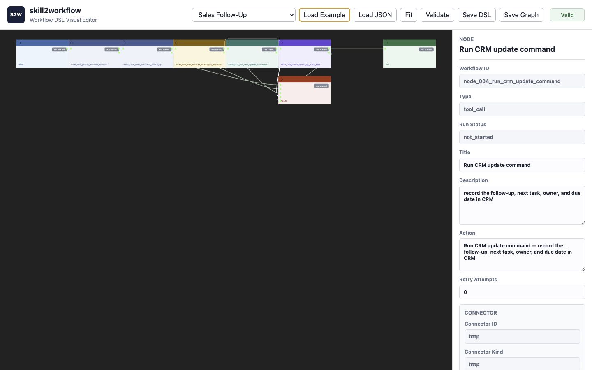
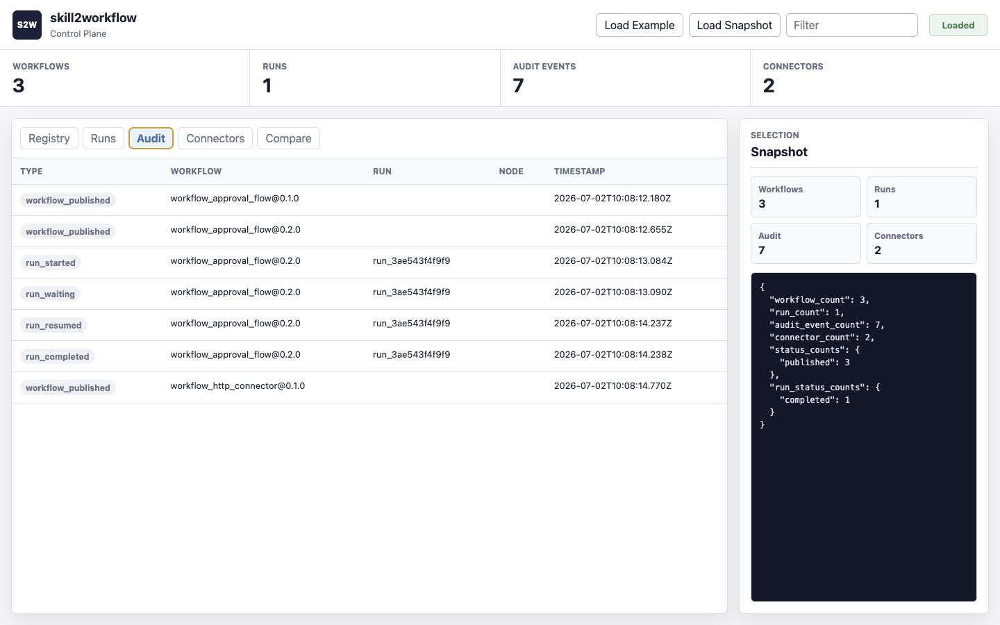
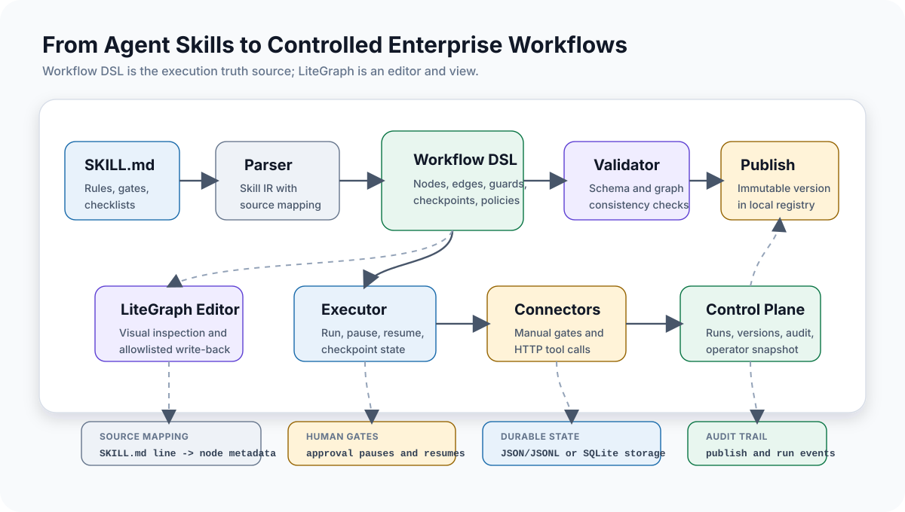

# skill2workflow

From Agent Skills to Controlled Enterprise Workflows.

`skill2workflow` compiles `SKILL.md` into workflows that can be validated,
published, paused for human approval, resumed, recovered and audited.

Current maturity is **Self-hosted Beta**: a self-hosted, single-tenant runtime
for one team, with Python 3.9+ standard-library runtime code and SQLite
production persistence. Workflow DSL remains the execution source of truth;
LiteGraph is an editor and operational view. The runtime does not claim exactly-once execution,
hosted multi-tenancy, built-in TLS or automatic reconciliation of unknown
external side effects.

[Documentation](docs/) · [Changelog](CHANGELOG.md) · [Security](SECURITY.md) ·
[Support](SUPPORT.md) · [Governance](GOVERNANCE.md) ·
[Contributing](CONTRIBUTING.md) · [Code of Conduct](CODE_OF_CONDUCT.md)

The controlled loop is:

```text
SKILL.md -> Skill IR -> Workflow DSL -> Immutable publication
Authenticated service -> Durable run -> Human decision -> Audit / recovery
```

## Fastest Controlled Journey

From a source checkout, install and create a new private workspace:

```bash
python3 -m venv .venv
source .venv/bin/activate
python -m pip install .
skill2workflow quickstart \
  --root /tmp/skill2workflow-quickstart \
  --port 8080
```

The bundled example is compiled, published into SQLite and **stops at a human
gate**. It makes no external connector call. The command never overwrites an
existing root and never prints the generated ingress secret.

The JSON result contains `run_id`, `state_dir` and secret-free
`operator_commands` arrays. Inspect the waiting run before making an explicit
approve/reject decision. The [installed controlled quickstart](docs/quickstart.md)
shows the exact inspection, approval and service-start commands.

To preview your own controlled Skill and non-secret business input, use
another unused absolute root:

```bash
skill2workflow quickstart \
  --root /tmp/skill2workflow-custom \
  --skill /absolute/path/to/SKILL.md \
  --input /absolute/path/to/input.json \
  --port 8080 --dry-run
```

This preview creates no workspace, run or token. Remove `--dry-run` only after
reviewing the result. A custom Skill must reach a real human gate before any
non-manual connector on its initial success path; quickstart never inserts
approval into an uncontrolled process. Omit `--input` only when `{}` satisfies
the input contract and required mappings.

For executable result checks, [declare HTTP JSON assertions](docs/http-json-assertions.md).
For API calls, [declare HTTP actions](docs/skill-http-actions.md) and
[typed trigger inputs](docs/skill-input-contracts.md). Review endpoints,
credential handles and response retention before approval.

## Quickstart

### Installed wheel quickstart

Already have a reviewed wheel? Install it with `python -m pip install /path/to/skill2workflow.whl`
and use the same `quickstart` command above. See the [complete guide](docs/quickstart.md)
for the non-overwrite boundary, custom input and authenticated second trigger.

### Source-checkout contributor demo

```bash
python3 scripts/demo_bootstrap.py --work-dir /tmp/skill2workflow-demo
```

This **contributor demo automatically resumes its example gate** and resets
its work directory by default. It is not the operator approval journey above.
Use `--no-reset` to keep existing files. See [Contributing](CONTRIBUTING.md)
for tests and [examples](docs/examples.md) for repeatable scenarios.

## Use The Editor

```bash
skill2workflow ui --port 4173
```

Open [the editor](http://127.0.0.1:4173/web/) or
[the control-plane inspector](http://127.0.0.1:4173/web/control.html).
The loopback UI bundles its LiteGraph assets locally and needs no CDN.

Choose a local Skill and select **Compile SKILL**, inspect the draft and
validate before publication. Compilation is not execution. The editor can
check ephemeral, non-secret input, preserve newer drafts during imports and
export allowlisted edits back through Workflow DSL validation.
See [authoring](docs/authoring.md) and [installed UI](docs/installed-ui.md).
Live operational views require an explicit service origin and protected token
file; the token is not sent to the browser.

## Visual Overview

### Controlled Workflow Authoring



The graph is a review/editing surface, not a second execution authority.

### Local Control Plane And Audit Trail



Inspect exported snapshots, or connect the installed UI to one authenticated
service for bounded live inspection and explicit operator actions.

### System Design



## Why This Exists

Skills describe how an agent should work. Operational workflows also need
enforced ordering, durable state, approval, retries, versioning and an audit
trail. This project makes those controls explicit and inspectable.

Compilation is conservative. It does not turn arbitrary prose into trusted
business automation or execute embedded shell/code examples. Review inferred
manual steps and use explicit supported declarations for approvals, HTTP calls,
input contracts and versions.

## Current Product Boundary

| Task | Supported path |
| --- | --- |
| Write and review a process | [Skill input contract](docs/skill-input-boundary.md), [authoring](docs/authoring.md), [examples](docs/examples.md) |
| Test business input without running | [Workflow preflight](docs/workflow-preflight.md), including the canonical 1 MiB input limit |
| Publish an edited Skill as a new immutable version | [Skill workflow versions](docs/skill-workflow-versions.md), [workflow releases](docs/workflow-releases.md) |
| Share reviewed local artifacts | [Workflow bundles](docs/workflow-bundles.md) with verification and separate execution consent |
| Deploy one team instance | [Secure service bootstrap](docs/service-bootstrap.md), [go-live checklist](docs/go-live.md), [Docker](docs/docker-self-host.md), [systemd](docs/systemd-service.md) |
| Approve, trigger and schedule | [Human approval](docs/human-approval.md), [triggers](docs/triggers.md), [recurring scheduling](docs/recurring-scheduling.md) |
| Diagnose and recover | [Service Doctor](docs/service-doctor.md), [run detail](docs/run-detail.md), [backup/restore](docs/backup-restore.md), [interrupted recovery](docs/interrupted-recovery.md) |
| Extend integrations safely | [Connectors](docs/connectors.md), [credentials](docs/credential-boundary.md), [runtime policy](docs/runtime-policy.md) |

Use SQLite for the self-hosted production boundary. JSON/JSONL remain available
for local examples and evaluation. Business input is durable run data, not a
credential store; secrets belong behind credential handles, not in Skills,
Workflow DSL or shared fixtures.

Cancellation is cooperative and cannot undo an in-flight external effect.
Unknown effects require operator reconciliation, not automatic replay.
Public ingress needs separately managed TLS and deployment review.

For a task-oriented route through all features, use the
[documentation guide](docs/README.md); the [complete guide reference](docs/reference.md)
covers individual contracts, command boundaries and evidence.

## Architecture

The approved five layers are:

1. Skill Ingestion / Parser
2. DSL Compiler / Validator
3. LiteGraph Editor
4. Durable Executor
5. Enterprise Control Plane

Published workflow versions are immutable. Run state, registry metadata and
audit evidence use JSON/JSONL or SQLite; the graph and read-only reports do not
override Workflow DSL. See the [DSL contract](docs/workflow-dsl-contract.md)
and [compatibility policy](docs/workflow-dsl-compatibility.md).

## Repository Layout

```text
src/skill2workflow/   Python runtime and CLI
web/                 Packaged editor and control-plane inspector
examples/            Skills, workflows, connector fixtures and observability
schemas/             Versioned JSON contracts
tests/               Python and editor behavior tests
scripts/             Contributor and release qualification tools
docs/                Task guides, contracts, specs and delivery evidence
CONTRIBUTING.md       Setup, tests and contribution workflow
ROADMAP.md           Readiness gates and delivery history
```

## Roadmap

Current maturity: Self-hosted Beta. Delivery Loops 1-285 are complete.
Production Baseline remains directional; passing an individual drill does not
promote maturity. Loop 40 completed a paid assisted Pilot under one scoped
Lark/Feishu `create_task` boundary, not general live SaaS readiness.
See [the evidence](docs/pilot-evidence/loop-40/), [pilot boundary](docs/controlled-live-pilot.md)
and [`ROADMAP.md`](ROADMAP.md) for current decisions and detailed history.

For changes, start with [Contributing](CONTRIBUTING.md).
For packaged compatibility and release evidence, see
[stability](docs/stability.md) and the [release process](docs/release-process.md).

## License

[Apache-2.0](LICENSE).
